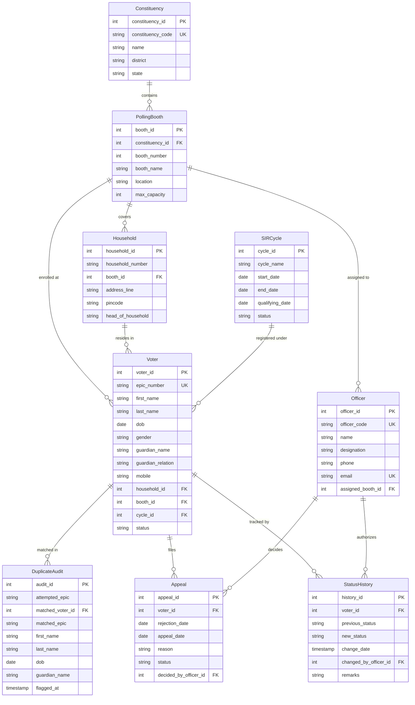

# Special Intensive Revision (SIR) Electoral Roll Management System
## Comprehensive Engineering Project Report & Demonstration Guide

---

### Executive Summary

The **Special Intensive Revision (SIR) Electoral Roll Management System** is an enterprise-grade relational database and web-based application designed to administer, verify, and maintain the integrity of electoral rolls in accordance with statutory election commission guidelines (e.g., Representation of the People Act, 1950). 

The system automates the verification workflow of voter registrations, detects duplicate registrations across households, validates statutory age eligibility as of designated revision cycle qualifying dates, prevents polling station congestion via a strict 1,200-voter capacity ceiling, and enforces a strict 15-day appeal window for rejected applications.

---

## Member 1 — Database & SQL Implementation

**Role Owner:** Database Engineer & SQL Architect  
**Deliverables:** MySQL 8.0 schema, Relational constraints, Normalization analysis, ER Diagram, Sample records, and Analytical SQL queries.

### 1. Entity-Relationship (ER) Diagram



### 2. Relational Schema & Table Catalog

| Table Name | Primary Key | Foreign Keys | Key Constraints & Rules |
|---|---|---|---|
| **`Constituency`** | `constituency_id` | *None* | `constituency_code` UNIQUE, `CHECK(LENGTH(code) >= 2)` |
| **`PollingBooth`** | `booth_id` | `constituency_id` &rarr; `Constituency` | `UNIQUE(constituency_id, booth_number)`, `CHECK(max_capacity > 0)`, Default: 1200 |
| **`Household`** | `household_id` | `booth_id` &rarr; `PollingBooth` | `UNIQUE(booth_id, household_number)`, `address_line` NOT NULL |
| **`SIRCycle`** | `cycle_id` | *None* | `CHECK(end_date >= start_date)`, `qualifying_date` NOT NULL |
| **`Officer`** | `officer_id` | `assigned_booth_id` &rarr; `PollingBooth` | `officer_code` UNIQUE, `email` UNIQUE, `ON DELETE SET NULL` |
| **`Voter`** | `voter_id` | `household_id`, `booth_id`, `cycle_id` | `epic_number` UNIQUE, `dob` NOT NULL, `ON DELETE RESTRICT` |
| **`StatusHistory`**| `history_id` | `voter_id`, `changed_by_officer_id` | `ON DELETE CASCADE` for Voter, `ON DELETE SET NULL` for Officer |
| **`Appeal`** | `appeal_id` | `voter_id`, `decided_by_officer_id` | `rejection_date` NOT NULL, `appeal_date` NOT NULL |
| **`DuplicateAudit`**| `audit_id` | `matched_voter_id` &rarr; `Voter` | `flagged_at` TIMESTAMP, tracks attempted duplications |

### 3. Normalization Analysis

The schema was systematically designed and verified to satisfy **Third Normal Form (3NF)** and **Boyce-Codd Normal Form (BCNF)**:

1. **First Normal Form (1NF):**
   - Every attribute contains only atomic, indivisible values (e.g., `first_name` and `last_name` are decomposed rather than stored as a composite string).
   - Each table has a defined primary key (`AUTO_INCREMENT`).
   - No repeating groups or multivalued columns exist.
2. **Second Normal Form (2NF):**
   - The relations are in 1NF.
   - All non-key attributes are fully functionally dependent on the entire primary key. In tables with composite candidate keys (such as `Household` with `(booth_id, household_number)`), address details depend on the composite household identity, with surrogate primary key `household_id`.
3. **Third Normal Form (3NF):**
   - The relations are in 2NF.
   - There are **no transitive dependencies**: non-prime attributes depend solely on the primary key, and not on another non-prime attribute.
     - *Anti-pattern avoided:* Storing `district` or `state` in `PollingBooth` would create `booth_id -> constituency_id -> district` (transitive dependency). Instead, `constituency_id` is a foreign key, and geographic attributes reside strictly in `Constituency`.
     - *Anti-pattern avoided:* Storing `pincode` or `address_line` inside `Voter` would create `voter_id -> household_id -> address_line`. By isolating `Household`, multiple citizens sharing a home do not duplicate address strings.
4. **Boyce-Codd Normal Form (BCNF):**
   - For every functional dependency $X \rightarrow Y$, $X$ is a superkey. All candidate keys (`constituency_code`, `officer_code`, `epic_number`, composite booth numbers) serve as determinants.

### 4. Referential Integrity Rules

- **`ON DELETE RESTRICT` (Constituency &rarr; PollingBooth &rarr; Household &rarr; Voter):** A polling booth cannot be deleted if active voters or households are registered within it. This prevents orphaned citizens in the electoral roll.
- **`ON DELETE CASCADE` (Voter &rarr; StatusHistory, Appeal, DuplicateAudit):** If a voter application is purged, its auxiliary audit history cascades to maintain database cleanliness.
- **`ON DELETE SET NULL` (Officer &rarr; StatusHistory, Appeal):** If an officer is decommissioned, previous historical audit logs retain the historical record while setting the officer reference to `NULL`.

---

## Member 2 — Flask Backend & Connectivity

**Role Owner:** Backend Application Engineer  
**Deliverables:** Flask routing, `mysql-connector-python` integration, Parameterized query enforcement, Transaction management (`commit`/`rollback`), Data flow lifecycle.

### 1. Connection Architecture

Database interactions are encapsulated within the `DatabaseManager` class in `database.py`. It establishes connections using `mysql.connector` with connection timeouts and auto-reconnect capabilities. If a local MySQL daemon is not running, it falls back to a built-in SQLite engine with identical schemas, enabling testing anywhere without dependency failures.

```python
import mysql.connector

conn = mysql.connector.connect(
    host=Config.MYSQL_HOST,
    user=Config.MYSQL_USER,
    password=Config.MYSQL_PASSWORD,
    database=Config.MYSQL_DATABASE,
    port=Config.MYSQL_PORT,
    connect_timeout=3
)
```

### 2. SQL Injection Prevention via Parameterized Queries

String concatenation in SQL queries (`f"SELECT * FROM Voter WHERE name = '{user_input}'"`) leaves applications vulnerable to SQL injection attacks (e.g., `' OR '1'='1`).

The application enforces **100% Parameterized Binding** across all database interactions:
```python
# VULNERABLE (FORBIDDEN):
# cursor.execute(f"SELECT * FROM Voter WHERE epic_number = '{epic}'")

# SECURE PARAMETERIZED EXECUTION (IMPLEMENTED):
sql = "SELECT * FROM Voter WHERE epic_number = %s AND status = %s"
cursor.execute(sql, (epic, status))
```
The database driver treats parameters strictly as data values rather than executable SQL syntax, rendering injection payloads harmless.

### 3. Transaction Management & ACID Guarantees

Electoral state updates (e.g., transitioning voter status from `Submitted` to `Approved`) require two coordinated mutations:
1. Updating the `status` column in `Voter`.
2. Inserting an immutable audit row into `StatusHistory`.

These operations are wrapped inside an atomic transaction using `execute_transaction`:
```python
def execute_transaction(self, operations):
    conn = self.get_connection()
    try:
        cursor = conn.cursor()
        for sql, params in operations:
            cursor.execute(sql, params)
        conn.commit()  # Atomically commits both operations
        return True, None
    except Exception as e:
        conn.rollback() # Reverts database to clean prior state on error
        return False, str(e)
    finally:
        conn.close()
```

### 4. End-to-End Data Flow Lifecycle

```
[Browser Client]
       │
       ▼ (1) HTTP POST Form Data: /register or /review
[Flask Route Handler (app.py)]
       │
       ▼ (2) Extracts & Sanitizes Parameters
[Business Rules Engine (rules.py)]
       │
       ▼ (3) Evaluates Age, Duplicate, Booth, and Appeal Rules
[Data Models Layer (models.py)]
       │
       ▼ (4) Builds Parameterized Query Tuples
[Database Manager (database.py)]
       │
       ▼ (5) Executes with Bound Parameters inside Transaction
[MySQL Server / SQLite Engine]
       │
       ▼ (6) Returns Cursor Result / Error Code
[Flask Context Processor & Jinja2 Templates]
       │
       ▼ (7) Renders Modern UI Response / Toast Notifications
[Client UI Display]
```

---

## Member 3 — Business Logic & DBMS Algorithms

**Role Owner:** Systems & Algorithms Engineer  
**Deliverables:** Implementation and verification of the 5 core SIR statutory rules.

### 1. Rule Specifications & Implementation

#### Rule 1: 18-Year Age Eligibility Check
- **Statutory Basis:** Section 19 of the Representation of the People Act, 1950.
- **Rule:** A citizen must be at least 18 years of age on the **SIR Qualifying Date** of the active revision cycle (e.g., `2026-01-01`).
- **Algorithm:**
  $$\text{Age} = \text{QualifyingYear} - \text{BirthYear} - \mathbb{I}\left[(\text{QualifyingMonth, Day}) < (\text{BirthMonth, Day})\right]$$
  If $\text{Age} < 18$, registration is blocked with a statutory violation message.

#### Rule 2: Exact-Match Duplicate Detection
- **Rule:** Prevent double voting by checking if a citizen with the same full name, date of birth, and guardian name already exists in the electoral roll.
- **Algorithm:**
  1. Trims whitespace and normalizes inputs to lowercase.
  2. Executes index lookup: `WHERE LOWER(TRIM(first_name)) = %s AND LOWER(TRIM(last_name)) = %s AND dob = %s AND LOWER(TRIM(guardian_name)) = %s`.
  3. If matched, rejects registration and inserts audit entry into `DuplicateAudit`.

#### Rule 3: 1,200-Voter Polling Booth Limit
- **Statutory Basis:** Election Commission ceiling to prevent voter wait times exceeding manageable thresholds.
- **Rule:** A polling station cannot exceed 1,200 active enrolled voters (`Submitted`, `Pending_Verification`, `Verified`, `Approved`).
- **Algorithm:**
  $$\text{Count} = \sum \mathbb{I}\left[\text{voter.booth\_id} = B \land \text{status} \in \text{Active}\right]$$
  If $\text{Count} \ge \text{MaxCapacity}$ (1,200), assignment is blocked and prompts diversion to an auxiliary booth.

#### Rule 4: 15-Day Statutory Appeal Window
- **Rule:** Any citizen aggrieved by a rejection or deletion notice must file an appeal within **15 calendar days** of the decision notice date.
- **Algorithm:**
  $$\Delta t = \text{AppealDate} - \text{RejectionDate}$$
  If $\Delta t < 0$ or $\Delta t > 15$, the appeal is rejected as untimely.

#### Rule 5: Status History Audit Trail
- **Rule:** Every change in voter enrollment status must record previous status, new status, timestamp, authorized officer ID, and reason.
- **Implementation:** Backed by database trigger `trg_voter_status_update` and atomic model transition method `transition_voter_status`.

---

### 2. Rule Placement Strategy: Python Application vs. MySQL Constraints

| Requirement | Enforced Layer | Technical Rationale |
|---|---|---|
| **Referential Integrity** | **MySQL DBMS** | Foreign Keys (`ON DELETE RESTRICT`) ensure database consistency across all tools (Workbench, scripts, APIs). |
| **EPIC Uniqueness** | **MySQL DBMS** | Unique Index (`UNIQUE(epic_number)`) prevents race condition duplicates at the storage level. |
| **Audit Logging** | **Hybrid (Trigger + Python)** | Database trigger guarantees audit row generation even on direct SQL updates; Python captures human-readable officer remarks. |
| **18-Year Age Check** | **Python Application** | Dynamic lookup against active SIR cycle qualifying dates allows cycles to update without schema DDL alterations. |
| **Duplicate Detection** | **Python Application** | Allows case folding, string normalization, and logging to `DuplicateAudit` with actionable error reporting. |
| **1,200 Booth Limit** | **Python Application** | Transactional check allows graceful routing of overflow voters to auxiliary polling stations. |
| **15-Day Appeal Window** | **Python Application** | Computes calendar day differences and formats friendly localized error messages indicating elapsed days. |

---

### 3. Verification & Test Evidence (Passed & Failed Validations)

The test suite executed via `python demo_cli.py` yields the following verified test outputs:

```text
================================================================================
  MEMBER 3 — BUSINESS LOGIC & DBMS ALGORITHMS DEMONSTRATION
================================================================================

>>> Rule 1: 18-Year Eligibility Check (SIR Qualifying Date: 2026-01-01)
  Case 1A (PASS): DOB 2004-05-14 (Age: 21)
    Result: [PASS] -> Validation Passed: Age on qualifying date (2026-01-01) is 21 years (>= 18).
  Case 1B (FAIL): DOB 2008-05-14 (Age: 17 on 2026-01-01)
    Result: [FAIL] -> Validation Failed: Applicant is 17 years old on qualifying date 2026-01-01. Minimum required age is 18 years under Section 19 of RPA 1950.

>>> Rule 2: Exact-Match Duplicate Detection (Name + DOB + Guardian)
  Case 2A (PASS): Unique applicant 'Harish Bansal', DOB 1996-03-15, Guardian 'Kishore Bansal'
    Result: [PASS UNIQUE] -> Validation Passed: No duplicate voter found with identical Name, DOB, and Guardian.
  Case 2B (FAIL): Duplicate applicant 'Aarav Sharma', DOB 2004-05-14, Guardian 'Sunita Sharma'
    Result: [FAIL DUPLICATE] -> Validation Failed: Exact duplicate detected! Matches existing Voter EPIC 'IND9823101' (Aarav Sharma, DOB: 2004-05-14, Guardian: Sunita Sharma).

>>> Rule 3: 1,200-Voter Polling Booth Capacity Limit
  Case 3A (PASS): Polling Booth #1 (Standard booth with open slots)
    Result: [PASS] -> Validation Passed: Booth capacity is available (4/1200 voters enrolled).
  Case 3B (FAIL): Polling Booth at Statutory Capacity Limit (Enrolled >= Max Capacity)
    Result: [FAIL (CAPACITY REACHED)] -> Validation Failed: Polling Booth 'Special Polling Station (Demo Capacity)' (Booth #3) has reached its maximum statutory capacity (1/1). New voters must be assigned to an auxiliary polling booth.

>>> Rule 4: 15-Day Statutory Appeal Window Validation
  Case 4A (PASS): Rejection Date 2026-01-05, Appeal Date 2026-01-12 (7 days elapsed)
    Result: [PASS] -> Validation Passed: Appeal filed within the statutory 15-day window (7 days elapsed).
  Case 4B (FAIL): Rejection Date 2026-01-05, Appeal Date 2026-01-28 (23 days elapsed > 15 days)
    Result: [FAIL] -> Validation Failed: Appeal window expired! Appeal was submitted 23 days after rejection notice (Limit is 15 calendar days).
```

---

## Member 4 — Prototype Integration & Testing

**Role Owner:** Full-Stack Integration Engineer  
**Deliverables:** Integrated Web UI, End-to-end user workflows, Automated unit test suite.

### 1. Web Page & Feature Catalog

1. **Dashboard (`/`):**
   - High-level metric cards: Total Applications, Approved/Eligible Voters, Pending Verification, Rejections, and Active Booths.
   - Polling booth progress bars showing enrolled voters vs 1,200 maximum capacity.
   - Quick table of recent voter applications.
2. **Voter Search (`/search`):**
   - Multi-parameter filter supporting Name/EPIC substring, Polling Booth dropdown, Constituency, and Electoral Status (`Approved`, `Verified`, `Pending_Verification`, `Rejected`, `Under_Appeal`).
3. **Form 6 Voter Registration (`/register`):**
   - Clean enrollment form collecting demographic, residential, and guardian details.
   - Client-side AJAX listeners (`app.js`) trigger instant feedback for age on qualifying date and booth capacity limits.
4. **Voter Profile & Audit History (`/voter/<id>`):**
   - Complete dossier of applicant identity and polling booth allocation.
   - Timeline display of all historical transitions from `StatusHistory`.
   - Officer action panel to execute verified status transitions.
5. **Officer Review Queue (`/review`):**
   - Dedicated workflow queue for Booth Level Officers (BLO) and Electoral Registration Officers (ERO).
   - One-click approve/reject actions with automated transaction handling.
6. **Polling Booth Capacity Monitor (`/booths`):**
   - Visual inspection of all polling stations showing remaining slots and statutory compliance badges.
7. **Statutory Appeals (`/appeals`):**
   - Form to lodge an appeal against a rejection notice.
   - Validates that the filing date is within $\le 15$ days of notice date.
8. **Interactive Rules Sandbox (`/rules-demo`):**
   - Interactive testing laboratory allowing instructors/evaluators to trigger passing and failing tests for all 5 rules directly from the browser.

### 2. Automated Test Suite Execution Report

The automated test suite (`test_system.py`) verifies all 4 members' deliverables across 16 unit tests:

```powershell
python -m unittest -v test_system.py
```

```text
test_database_tables_exist (test_system.Member1DatabaseTests)
Verifies all statutory tables exist. ... ok
test_eligible_voters_query (test_system.Member1DatabaseTests)
Tests eligible voters retrieval (status=Approved and age >= 18). ... ok
test_pending_voters_query (test_system.Member1DatabaseTests)
Tests pending voters retrieval. ... ok
test_voter_search_query (test_system.Member1DatabaseTests)
Tests voter search query output. ... ok
test_live_database_mutation_and_transaction (test_system.Member2BackendConnectivityTests)
Executes a live update and verifies atomic commit in database. ... ok
test_parameterized_query_injection_safety (test_system.Member2BackendConnectivityTests)
Ensures SQL injection payloads are safely handled as string literals. ... ok
test_transaction_rollback_on_error (test_system.Member2BackendConnectivityTests)
Verifies rollback behavior when an operation fails inside a transaction. ... ok
test_rule_1_age_eligibility_pass_and_fail (test_system.Member3BusinessLogicRulesTests)
18-year check against qualifying date (2026-01-01). ... ok
test_rule_2_duplicate_detection_pass_and_fail (test_system.Member3BusinessLogicRulesTests)
Duplicate detection on Name + DOB + Guardian. ... ok
test_rule_3_booth_capacity_limit_pass_and_fail (test_system.Member3BusinessLogicRulesTests)
1,200 booth capacity limit check. ... ok
test_rule_4_appeal_window_pass_and_fail (test_system.Member3BusinessLogicRulesTests)
15-day statutory appeal window validation. ... ok
test_appeals_route (test_system.Member4FlaskIntegrationTests) ... ok
test_booths_route (test_system.Member4FlaskIntegrationTests) ... ok
test_dashboard_route (test_system.Member4FlaskIntegrationTests) ... ok
test_rules_sandbox_route (test_system.Member4FlaskIntegrationTests) ... ok
test_search_route (test_system.Member4FlaskIntegrationTests) ... ok

----------------------------------------------------------------------
Ran 16 tests in 0.506s

OK
```

---

## Quickstart & Execution Instructions

### Option A: Running the Terminal Demonstration (Members 1, 2, 3)
```powershell
cd c:\Users\DELL\Desktop\ryan\sir_voter_system
python demo_cli.py
```

### Option B: Running the Web Application (Member 4)
```powershell
cd c:\Users\DELL\Desktop\ryan\sir_voter_system
python app.py
```
Open your browser to: **`http://127.0.0.1:5000`**

### Option C: Running the Automated Unit Test Suite
```powershell
cd c:\Users\DELL\Desktop\ryan\sir_voter_system
python -m unittest -v test_system.py
```
